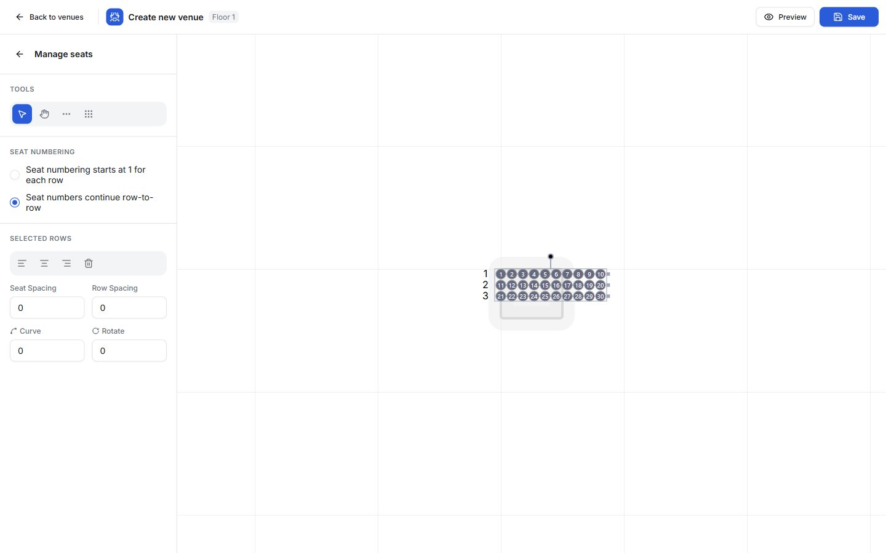

# Venue Designer

An SVG editor for building venue layouts: floors, areas and seat maps for theatres, concert halls and stadiums.
Built with **React 19, TypeScript, Redux Toolkit / RTK Query, Tailwind CSS v4, Radix UI and plain SVG** (no canvas libraries).

**Live demo:** https://samvel97.github.io/venue-designer/



## Features

- **Floor plan editor**: draw floors and areas as rectangles, ellipses or free-form pen paths
- **Shape manipulation**: select, multi-select, drag, resize, rotate, flip, per-corner radius, copy/paste
- **Area types**: areas with seats, areas without seats, non-reserved (general admission) areas with a ticket count
- **Seat editor**: generate single rows or whole blocks of rows with configurable seat and row spacing; curve and rotate rows; choose seat numbering per row or continuous
- **Validation** before saving: area names are required, areas must lie inside a floor, every area needs seats or tickets
- **Multiple floors** with a layout preview of the whole venue
- **Pan and zoom** on an infinite grid
- **Draft autosave**: unsaved edits survive page reloads

## How it works

The editor renders everything as SVG and keeps geometry in Redux.
Layouts are serialized per floor as `{ floor, properties, areas }`, gzip-compressed with `pako`,
and sent through RTK Query endpoints.

In this standalone version the endpoints are served by a small in-browser backend
(`src/store/localBackend.ts`) that stores venues in `localStorage`.
To connect a real server, replace `localBaseQuery` in `src/store/baseQuery.ts` with
`fetchBaseQuery({ baseUrl })`. The endpoint definitions and components stay the same.

```
src/
  Layout/Layout/Areas/   floor + area editor (useAreas hook, reducer, SVG shapes)
  Layout/Layout/Seats/   seat editor (row generation, curving, numbering)
  components/primitives/ Radix + Tailwind UI primitives (button, dialog, switch, ...)
  components/editor/     editor chrome: header, floors panel, inspector fields
  components/canvas/     shared SVG shape renderers
  components/shared/     HallView preview of the whole venue, error boundary
  store/                 Redux slice, RTK Query API, local backend
  utils/                 geometry: rotation, bounding boxes, curved rows, validation
```

## Getting started

```bash
npm install      # Node 22.22+
npm run dev      # http://localhost:5173
npm run build    # type-check + production build in /build
npm test         # Vitest
npm run lint     # ESLint (flat config)
npm run format   # Prettier
```

Optional: set `VITE_HOME_URL` to embed the editor in a host application; "Back" will then return there.

## Background

I was the lead frontend developer of this editor, which I built with my team for a ticketing platform. This repository is a standalone
version with the product-specific backend, authentication and infrastructure removed.
